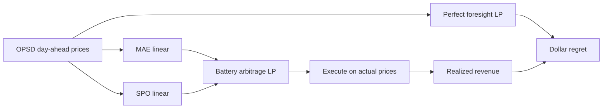
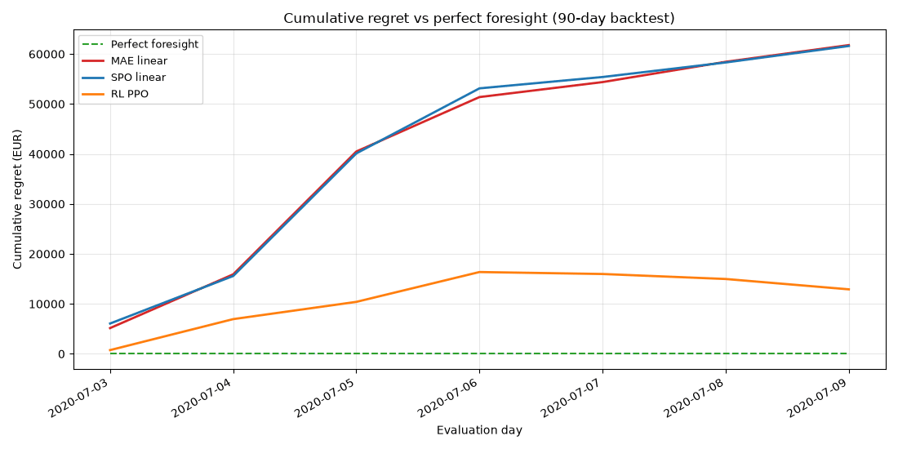
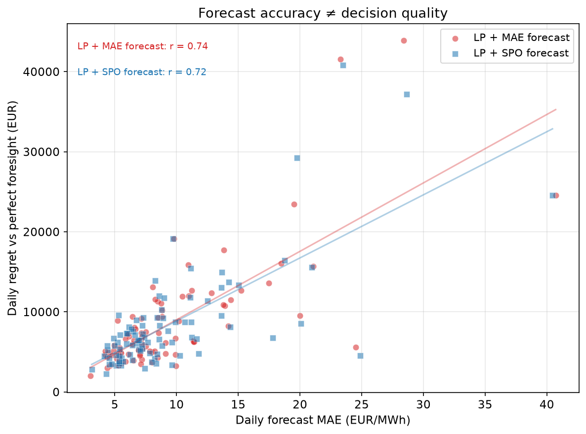
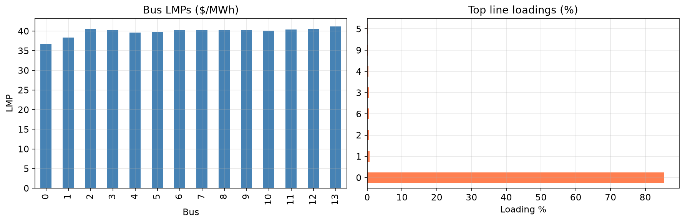
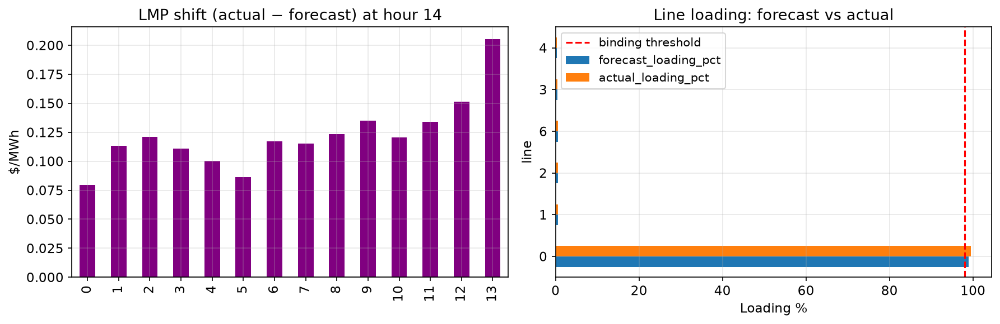

# battery-spo-rl

[](https://github.com/mehmetertac/battery-spo-rl/actions/workflows/ci.yml)


[](https://github.com/mehmetertac/battery-spo-rl/releases)

**We improved the forecast's MAE and lost money.**

On a 90-day German day-ahead battery arbitrage backtest (Jul–Sep 2020, 100 MW / 400 MWh storage), the MAE-optimal forecaster beat SPO on accuracy (9.38 vs 9.40 EUR/MWh) — and **lost EUR 9,198** in cumulative regret vs the decision-focused alternative.

Forecast accuracy is not the scoreboard. **Decision regret in dollars vs perfect foresight is.** Same linear features and the same battery arbitrage LP; only the training objective changes (MAE vs SPO+). Built for a **day-ahead storage desk** and for interviews where someone asks why MAE is the wrong metric once an optimizer sits in the loop.

→ [Short write-up: why decision-focused learning matters in energy markets](docs/mae-lost-money.md)

**Long-form article (placeholder):** *Why decision-focused learning beats accuracy-focused learning in energy markets* — link pending Saturday.

---

## The pipeline



Both forecasters use the same linear model and lag/calendar features. The difference is the training objective: MAE minimizes forecast error; SPO+ fine-tunes on the **LP-induced loss** (subgradients from the battery arbitrage optimizer). Schedules are executed against actual prices; regret = perfect-foresight revenue − approach revenue.

---

## Four-way capstone (90 days)

| Approach | Total revenue (EUR) | Cumulative regret (EUR) | Avg MAE (EUR/MWh) |
|---|---|---|---|
| LP + perfect foresight | 876,849 | 0 | — |
| LP + MAE forecast | 113,171 | 763,678 | 9.38 |
| RL agent (PPO) | 610,037 | 266,813 | n/a |
| **LP + SPO forecast** | **122,369** | **754,481** | **9.40** |

**Headline:** SPO loses on MAE (+0.02 EUR/MWh) and wins EUR 9,198 vs MAE on cumulative regret.

This repo scores **dollar regret and forecast MAE**, not probabilistic forecast bands (no quantile model here).

Regenerate: `python -m src.eval.capstone --days 90 --include-rl --skip-sensitivity` → `results/master_table.csv` and `results/regime_robustness.csv` (local, gitignored). Figures in `docs/figures/` were copied from the last capstone run.

RL PPO beats both forecast LPs but uses **intra-day realized price lags** — a richer information structure than day-ahead market submission. For production day-ahead dispatch, the honest comparison is MAE vs SPO. See [WEEK_07_REFLECTION.md](WEEK_07_REFLECTION.md).

---

## The money plot



Static figure: [docs/figures/cumulative_regret.png](docs/figures/cumulative_regret.png). Regenerate GIF: `python scripts/build_regret_demo_gif.py` (requires `results/regret.csv`).

SPO's cumulative regret curve sits below MAE's for most of the backtest despite slightly worse average forecast accuracy. The scatter plot makes the decoupling explicit:



**Regime split:** SPO wins on dollars in volatile weeks (−EUR 23,711 vs MAE); MAE wins in calm weeks (+EUR 14,514). The 90-day total still favors SPO. From `results/regime_robustness.csv` after the capstone CLI above.

---

## Why this happens

Traditional forecasting treats every EUR/MWh error as equal. Battery arbitrage does not: overpredicting a price spike vs missing one changes charge/discharge timing asymmetrically. **SPO+** (Elmachtoub & Grigas) trains on the loss induced in the downstream LP — the envelope subgradient reads off optimal net export as sensitivity to forecast perturbations.

This repo implements bias-only SPO+ fine-tuning on top of MAE-init OLS weights. Same LP, same features, different objective → different dollars.

---

## What this means in market terms

A day-ahead desk does not get paid for a low MAE on tomorrow's price curve — it gets paid for **charge/discharge timing** after the LP turns the forecast into MW. Pick the forecaster that minimizes **regret vs perfect foresight**, not the one that wins a accuracy leaderboard. The calm/volatile split matters: when prices swing, timing errors are expensive and SPO's LP-aware training shows up; in calm weeks MAE can still win on dollars — the 90-day total is the headline, but the regime table is what you defend in a trading interview.

---

## OPF: forecast error is not just an accuracy miss

IEEE 14-bus AC OPF (pandapower) connects scalar dispatch duals to **locational** LMPs and line congestion. Perturb loads with a synthetic forecast-vs-actual profile:



At peak load, forecast-load OPF can miss binding constraints that actual load reveals — **hidden congestion**:



A load forecast acceptable on MAE can still shift bus LMPs and hide binding transmission limits. The optimization layer converts errors into dollars and grid stress — which is why we measure regret, not MAE alone.

---

## Reproduce

```powershell
git clone https://github.com/mehmetertac/battery-spo-rl.git
cd battery-spo-rl
python -m venv .venv
.\.venv\Scripts\Activate.ps1
pip install -e .

# Sanity tests (synthetic data, no OPSD download)
pytest tests/ -q

# OPF figures (~1–2 min, no OPSD needed)
python -m src.eval.opf_scenario --hours 24 --save-figures

# Train PPO agent (~5 min CPU; first run downloads OPSD ~120 MB)
python -m src.rl.train --timesteps 50000 --output models/rl_ppo.zip

# Full capstone: backtest + master table + regime + figures (~35–45 min)
python -m src.eval.capstone --days 90 --include-rl --skip-sensitivity

# Replot from existing results/regret.csv (skip backtest)
python -m src.eval.capstone --skip-backtest --skip-sensitivity
```

Optional: drop `--skip-sensitivity` to run the 3×3 battery grid (efficiency × energy, LP-only, ~4–6 hours additional).

First OPSD run downloads DE-LU day-ahead prices to `data/opsd/`. Capstone outputs land in `results/`; committed figures for GitHub live in `docs/figures/`.

---

## Limitations (honest)

- **Toy single-zone LP** — one battery, no network, no unit commitment; not a production EMS model.
- **No market impact, no fees** — perfect round-trip efficiency **0.90** in the headline backtest; no degradation or cycling cost in the table.
- **Bias-only SPO+** on MAE-initialized linear weights — not full end-to-end SPO on a deep model.
- **90 days, DE-LU day-ahead (Jul–Sep 2020)** — one market window; regime split is illustrative.
- **RL (PPO) is not comparable** to MAE/SPO for day-ahead submission — it sees intra-day realized price lags.
- **README figures** are committed; numeric tables in `results/` are gitignored and must be regenerated locally.

---

## LP / LMP mental model

Linear programs optimize a linear objective subject to linear constraints. **Duals = shadow prices = LMPs:** the dual on the power-balance constraint is the marginal cost of serving one more MW at that hour.

| Problem type | Decision variables | Power systems example |
|---|---|---|
| Pure LP | Continuous (MW dispatch) | Economic dispatch, storage arbitrage |
| MILP | Continuous + binary (on/off) | Unit commitment |

Storage arbitrage exploits price differences: charge when LMP is low, discharge when LMP is high. The optimization layer converts forecasts into dollars.

### Day 1 toy: economic dispatch

```powershell
python -m src.dispatch
jupyter notebook notebooks/01_economic_dispatch_toy.ipynb
```

Three generators with different marginal costs dispatch to meet hourly demand. cvxpy solves the LP; duals on power balance equal the marginal generator cost (LMP).

---

## Project structure

```
battery-spo-rl/
├── docs/
│   ├── figures/          # Committed capstone + OPF plots (GitHub-rendered)
│   └── mae-lost-money.md # Short public write-up (Week 12 article seed)
├── src/
│   ├── dispatch/         # LP modules + IEEE 14-bus AC OPF (pandapower)
│   ├── forecast/         # Linear MAE/SPO forecasters, SPO+ loss
│   ├── rl/               # Gymnasium env + PPO training
│   └── eval/             # Regret backtest + capstone reporting CLI
├── notebooks/            # Exploratory walkthroughs
├── results/              # Local regenerate workspace (gitignored)
└── tests/                # Unit tests (synthetic data, no OPSD in CI)
```

Module API and status: [handover.md](handover.md). Agent workflow: [AGENT.md](AGENT.md).

---

## License

Apache 2.0 — see [LICENSE](LICENSE).
