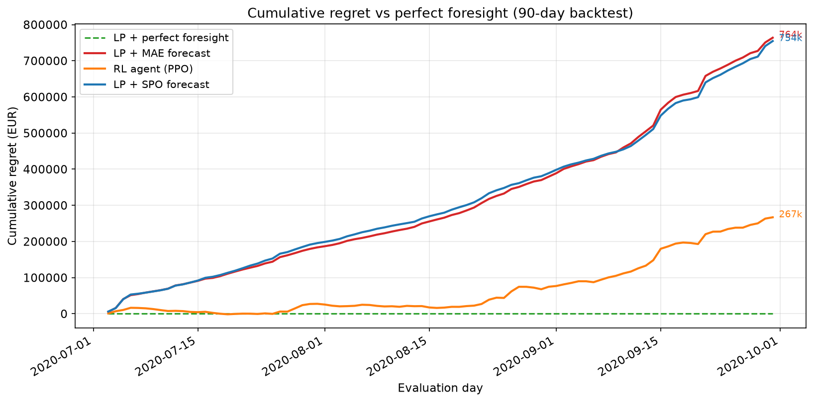
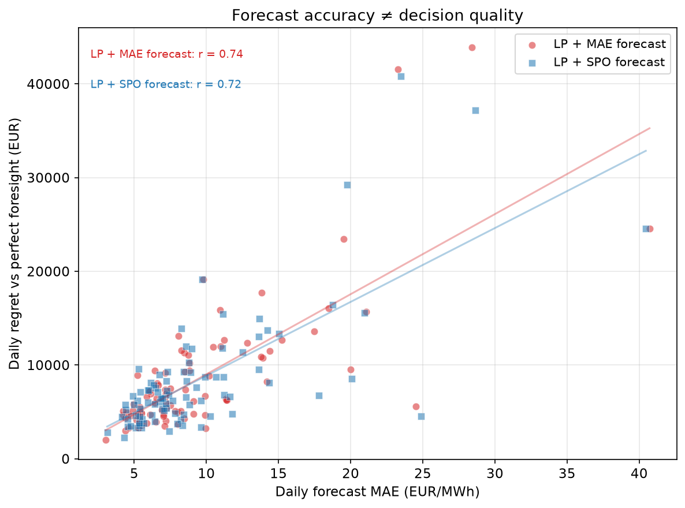
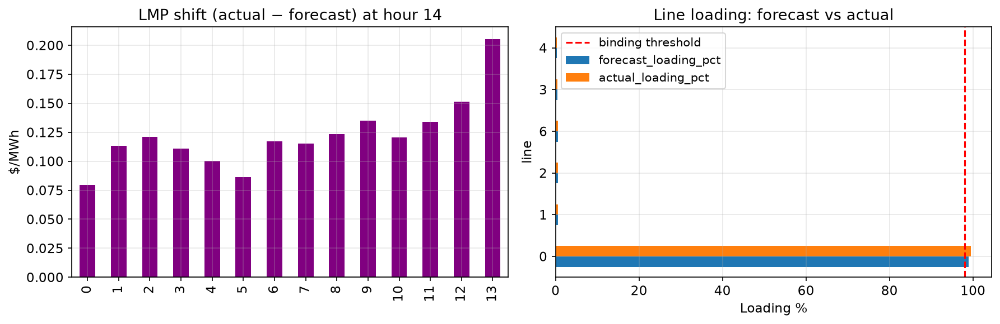

# Why decision-focused learning beats accuracy-focused learning in energy markets

Numbers and figures below come from the [battery-spo-rl](https://github.com/mehmetertac/battery-spo-rl) README and `docs/figures/` (90-day DE-LU day-ahead backtest, Jul–Sep 2020).

---

## 1. The setup

A battery arbitrage desk wakes up to tomorrow’s schedule. Overnight models have produced a day-ahead price curve; the trader’s job is not to admire the curve but to **submit charge and discharge** for a **100 MW / 400 MWh** storage asset through a linear program that respects round-trip efficiency, energy limits, and hourly balance. German day-ahead **DE-LU** prices from OPSD feed the same pipeline the repo uses: forecast → battery LP → execute against **actual** prices → realized revenue.

In that world, “good forecast” is whatever makes the LP earn money after the market clears. The desk receives a point forecast (and maybe a load forecast for a grid asset). The optimizer converts beliefs into megawatts. That conversion is where accuracy metrics and dollars part company.

---

## 2. The trap

Mean absolute error treats every **EUR/MWh** mistake as equally painful. Storage arbitrage is not symmetric. Overpredicting a price spike nudges the LP to hold empty capacity for discharge that never pays off; underpredicting a valley can leave MWh on the table when cheap energy was there to buy. The LP’s duals — shadow prices on power balance — tell you **which hours matter** for the schedule. A forecaster trained only to minimize MAE has no reason to weight those hours the way the optimizer does.

So the trap is institutional as much as statistical: data science ships a model with a lower MAE; trading asks why revenue moved the wrong way. Both teams can be “right” on their scoreboards while the P&L tells a third story.

---

## 3. The Week 7 experiment, plainly

The capstone in [battery-spo-rl](https://github.com/mehmetertac/battery-spo-rl) keeps the **same linear features** and the **same battery arbitrage LP**. Two forecasters differ only in training objective: **MAE** versus **SPO+** (Smart Predict-then-Optimize), bias-only fine-tuning on MAE-initialized weights that reads off LP subgradients when forecasts perturb.

For each approach the harness runs:

1. **Perfect foresight** — the LP sees actual prices (ceiling, not deployable).
2. **Point-forecast LP** — MAE or SPO linear forecast fed into the LP; schedule executed on actuals.
3. **RL (PPO)** — an agent trained in a Gymnasium arbitrage environment.

**Regret** is uniform across rows:

```
regret = perfect_foresight_revenue − approach_revenue
```

Over **90** days the perfect-foresight LP earns **EUR 876,849**; cumulative regret is **zero** by definition. The MAE forecaster realizes **EUR 113,171** (**763,678** regret). The SPO forecaster realizes **EUR 122,369** (**754,481** regret). PPO realizes **EUR 610,037** (**266,813** regret) but uses **intra-day realized price lags** — richer information than a day-ahead market submission allows. For production day-ahead dispatch, the honest comparison is **MAE vs SPO**, not PPO vs either forecaster.

---

## 4. The key result

| Approach | Total revenue (EUR) | Cumulative regret (EUR) | Avg MAE (EUR/MWh) |
|---|---|---|---|
| LP + perfect foresight | 876,849 | 0 | — |
| LP + MAE forecast | 113,171 | 763,678 | 9.38 |
| **LP + SPO forecast** | **122,369** | **754,481** | **9.40** |
| RL agent (PPO) | 610,037 | 266,813 | n/a |

The SPO-trained forecaster **loses on MAE** (**9.40** vs **9.38**) and **wins on dollars**: **EUR 9,198** less cumulative regret than MAE over the backtest.

Regime split (from `results/regime_robustness.csv` after the capstone CLI): in **volatile** weeks SPO’s regret advantage vs MAE is **EUR 23,711**; in **calm** weeks MAE wins **EUR 14,514** on dollars. The 90-day total still favors SPO — timing errors hurt most when prices swing.



*SPO’s cumulative regret curve stays below MAE’s for most of the window despite slightly worse average forecast error.*



*Better MAE does not imply lower regret once the same forecasts pass through the battery LP.*

---

## 5. Why this generalises

**Dispatch and congestion.** Scalar MAE on load is not scalar stress on the grid. The repo’s IEEE 14-bus AC OPF (pandapower) perturbs load with a synthetic forecast-vs-actual profile: bus LMPs and line loadings shift; a forecast acceptable on MAE can **hide binding transmission** until actual load reveals congestion.



*Forecast-load OPF can miss binding limits that actual load exposes — errors become locational dollars, not a single MAE.*

**Maintenance scheduling.** The same mindset appears on the asset side. On [wind-digital-twin](https://github.com/mehmetertac/wind-digital-twin), a RUL interval is not an end in itself. A **pessimistic P10** that fires an inspection early spends crane and labor; a **missed** failure spends multiples of that. Optimizing pinball loss on days-to-failure is accuracy-focused; optimizing **inspection cost vs avoided catastrophic replacement** is decision-focused — different objective, different operating point, same philosophy as SPO on the battery desk.

**Market bidding and reserves.** Bidders translate probabilistic beliefs into offers through constraints and risk tolerances. A reserve model with tight CRPS can still mis-order hours where the ISO’s scarcity pricing bites. The [energy-forecasting-service](https://github.com/mehmetertac/energy-forecasting-service-) stack keeps **P10–P90 bands** through TFT training, MLflow, Docker, and FastAPI because downstream desks need distributions that survive serving — not because the API prints MAE on a slide.

---

## 6. Senior judgment: forecasting is a means, not an end

Interviewers still ask “what’s your MAE?” because it is portable and fast to compute. Senior operators answer with **regret**, opportunity cost, and benchmark tracking error against a forward curve or internal optimizer. Forecast quality is a diagnostic on the path from belief to action; **decision regret is the scoreboard** once an LP, bid function, or maintenance policy sits in the middle.

Decision-focused learning — SPO+ for predict-then-optimize, and its cousins in other verticals — aligns training with that scoreboard without pretending the optimizer is differentiable end-to-end in every production stack. Here, bias-only SPO+ on a linear model is deliberately modest: if the headline survives that simplicity, the argument is about **objectives**, not about a heavyweight architecture.

---

## 7. Limits

Treat this repo as a teaching artifact, not an EMS product.

- **Toy single-zone LP** — one battery, no network, no unit commitment.
- **Perfect battery model** — round-trip efficiency **0.90**, no degradation, no fees, no market impact in the headline table.
- **90 days, DE-LU day-ahead (Jul–Sep 2020)** — one market window; regime splits are illustrative.
- **Bias-only SPO+** on linear weights — not full end-to-end SPO through a deep forecaster.
- **PPO** is included for RL literacy but is **not comparable** to MAE/SPO for day-ahead submission.

Reproduce the table and figures:

```powershell
pip install -e .
python -m src.eval.capstone --days 90 --include-rl --skip-sensitivity
```

~35–45 minutes on CPU; committed plots live in `docs/figures/`.

---

## Source repo

[battery-spo-rl](https://github.com/mehmetertac/battery-spo-rl) — battery LP, MAE vs SPO+ forecasters, four-way regret harness, pandapower OPF add-on.
